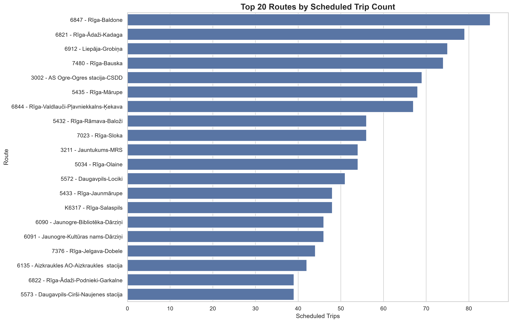
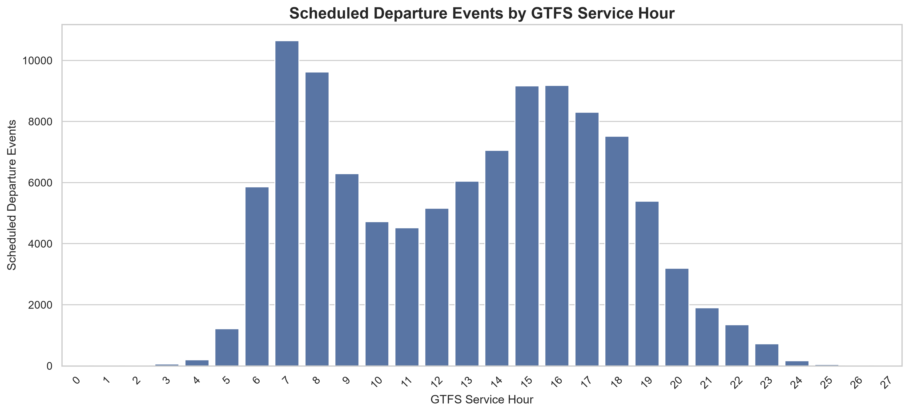
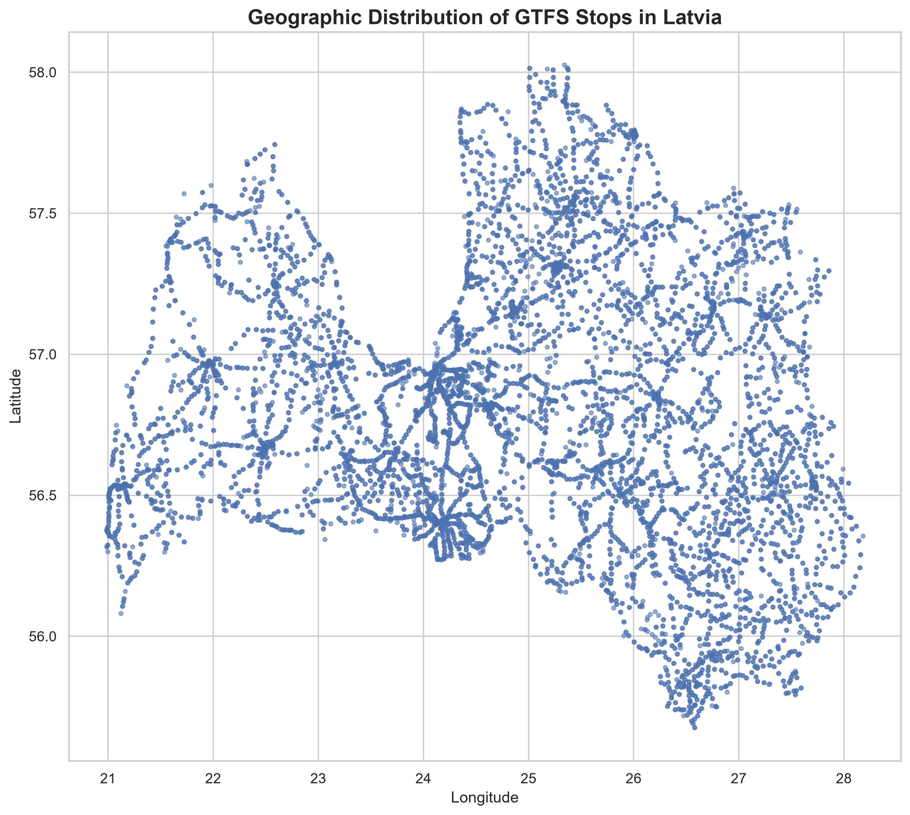
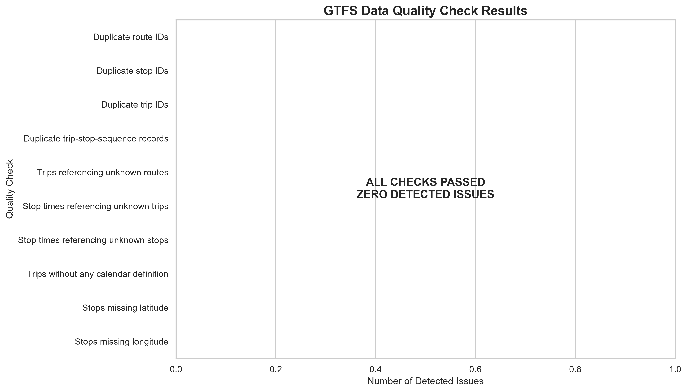

# BalticTransport-NLP


**Latvia Public Transport Analytics and Multilingual NLP**


A Python-based project combining Latvia's public transport GTFS timetable analysis with a multilingual transport and logistics NLP research pipeline for Latvian (LV), Russian (RU), and English (EN).


## Project Overview


This project has two connected components:


1. **Public Transport Analytics:** Explore Latvia's public transport network using GTFS timetable data, generate statistical reports, validate data quality, and present findings through an interactive Gradio dashboard.

2. **Multilingual NLP Research:** Build a documented pipeline for classifying transport and logistics texts into predefined topics across three languages.


## 1. GTFS Public Transport Analytics

### Dashboard Visualizations

The following visualizations summarize key findings from the Latvia GTFS timetable analysis.

#### 1. Top Routes



#### 2. Hourly Scheduled Service



#### 3. Geographic Distribution of Stops Across Latvia



#### 4. GTFS Data Quality Validation



The GTFS analysis uses public transport timetable data published by Autotransporta direkcija (ATD).

### Analysis performed


- Route, stop, and trip analysis.

- Scheduled departures by hour.

- Weekday service calendar analysis.

- Route and stop activity summaries.

- Calendar exception analysis.

- Geographic distribution of stops.

- GTFS data quality validation.

- Statistical reports and visualizations.


### Dataset summary


| Metric | Records |

|---|---:|

| Routes | 1,022 |

| Stops | 10,216 |

| Trips | 6,430 |

| Stop-time records | 108,390 |

| Calendar records | 6,428 |

| Calendar exceptions | 41,159 |


**Data quality:** All 10 implemented validation checks passed on the analyzed dataset.


### Interactive dashboard


The Gradio dashboard contains seven sections:


1. Overview

2. Route Analysis

3. Stop Analysis

4. Timetable Analysis

5. Calendar Analysis

6. Data Quality

7. NLP Classification


## 2. Multilingual NLP Research


The NLP component provides a starter pipeline for transport and logistics text classification.


### Supported languages


- Latvian (LV)

- Russian (RU)

- English (EN)


### Topic categories


- `delay`

- `safety`

- `tariffs`

- `infrastructure`

- `other`


### Planned methods


- Text cleaning and normalization.

- Duplicate detection.

- Exploratory data analysis.

- TF-IDF with Logistic Regression baseline.

- Optional multilingual transformer experimentation.

- Evaluation using macro-F1, accuracy, and per-language metrics.


**Important status note:** The included NLP dataset contains only 12 synthetic smoke-test examples. It is not a real news corpus and is insufficient for meaningful model training or performance claims. Real, permitted, manually reviewed data and proper model evaluation are still required.


## Technology Stack


- Python

- Pandas

- NumPy

- Matplotlib

- Scikit-learn

- Gradio

- GTFS

- Jupyter Notebook

- Git and GitHub


## Repository Structure


```text

BalticTransport-NLP/
├── config/
├── data/
│   └── sample_smoke_test.csv
├── docs/
│   ├── DATASET_CARD.md
│   ├── MODEL_CARD.md
│   ├── annotation_guidelines.md
│   └── data_sources.md
├── models/
├── notebooks/
│   └── baltictransport_eda.ipynb
├── reports/
│   └── gtfs/
├── src/
│   ├── app.py
│   ├── collect_rss.py
│   ├── eda.py
│   ├── gtfs_analysis.py
│   ├── gtfs_visualizations.py
│   ├── prepare_data.py
│   ├── train_baseline.py
│   └── train_xlmr.py
├── tests/
├── requirements.txt
├── README.md
├── LICENSE
└── .gitignore
```


## Getting Started


### Requirements


- Python 3.10 or later

- Git

- Windows, macOS, or Linux


### 1. Clone the repository


```bash

git clone https://github.com/Rohith-gargula/BalticTransport-NLP.git

cd BalticTransport-NLP

```


Replace `Rohith-gargula` with the GitHub account username.


### 2. Create a virtual environment


```bash

python -m venv .venv

```


Activate it on Windows:


```powershell

.venv\\Scripts\\Activate.ps1

```


### 3. Install dependencies


```bash

pip install -r requirements.txt

```


### 4. Obtain the GTFS dataset


Download the Latvia GTFS dataset from the official ATD source:


https://www.atd.lv/sites/default/files/GTFS/gtfs-latvia-lv.zip


Extract it into:


```text

data/raw/gtfs/atd/

```


The extracted directory should contain GTFS files such as `routes.txt`, `stops.txt`, `trips.txt`, and `stop_times.txt`.


The dataset archive and raw data are excluded from this Git repository.


### 5. Run GTFS analysis


```bash

python src/gtfs_analysis.py

```


### 6. Generate visualizations


```bash

python src/gtfs_visualizations.py

```


### 7. Launch the dashboard


```bash

python src/app.py

```


Open the local Gradio URL displayed in the terminal.


### 8. Run the NLP starter pipeline


```bash

python src/prepare_data.py

python src/eda.py

python src/train_baseline.py

```


The small synthetic dataset is intended for software testing only. The training script may refuse meaningful training until sufficient reviewed data is available.


## Data Sources and Responsible Use


The GTFS component uses public timetable data from ATD.


The NLP component is a research starter pipeline. Potential text sources must be checked for licensing, reuse permissions, and collection restrictions before data collection or redistribution.


See:


- `docs/data_sources.md`

- `docs/DATASET_CARD.md`

- `docs/MODEL_CARD.md`

- `docs/annotation_guidelines.md`


## Limitations


- GTFS represents scheduled service, not live vehicle positions.

- Scheduled departures do not establish actual punctuality or delays.

- Stop-time records are not passenger counts.

- Calendar exceptions must be considered when interpreting service on specific dates.

- The multilingual NLP dataset is currently synthetic and too small for meaningful model evaluation.

- A production-ready NLP classifier has not yet been established.


## Future Improvements


- Expand the multilingual dataset using permitted sources.

- Manually review and annotate transport-related texts.

- Train and evaluate classification models.

- Add more transport analytics and visualizations.

- Deploy the dashboard through a public hosting platform.


## Project Purpose


This project demonstrates practical work with Python, data analysis, GTFS data processing, data visualization, data quality validation, NLP pipeline design, and interactive dashboard development.
